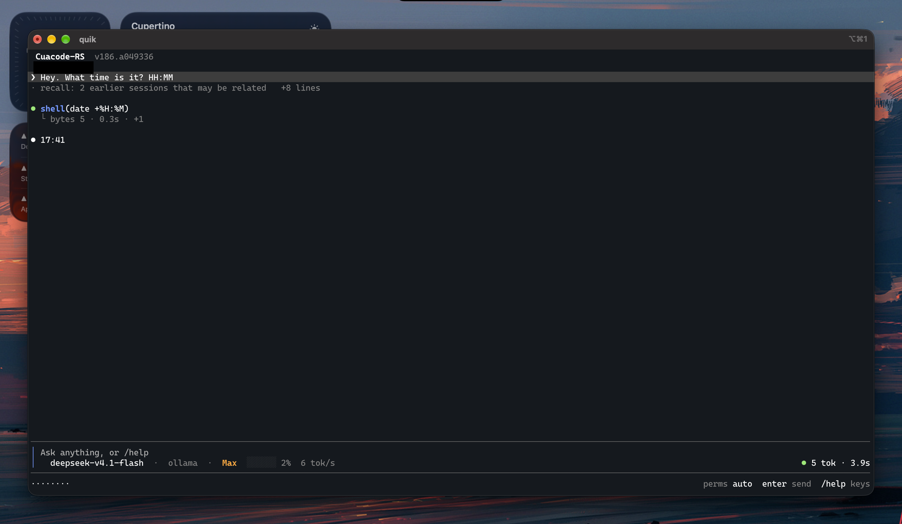

# CuaCode

An AI agent that runs on your computer and actually uses it.

It reads and writes files, runs commands, opens apps, clicks, types, and takes
screenshots. You watch it work in a terminal or in a window, and you can stop it
any time.



> [!WARNING]
> Still a work in progress. Not a virus, but back up anything you care about.
> Read a permission prompt before you say yes.

## What it does

Ask it to do something. It plans, uses the tools it needs, and tells you what it
did.

- "find every file over 100 MB in my home folder and tell me which are safe to delete"
- "this test is failing, find out why and fix it"
- "open the invoice pdf and pull the totals into a table"
- "watch that page and tell me when the price drops"

It also remembers. Things that stay true go into `~/.cuacode/memory`, one small
file per fact, and come back when they matter.

## Install

You need Python 3.10 or newer. You need Rust only if you want to build a frontend.

```bash
./install.sh
```

That makes a venv, installs the Python deps, builds the frontends, and puts a
`cuacode` command on your PATH. On Windows use `install.ps1`, and read
[CuaCode on Windows](WINDOWS.md) first.

```bash
cuacode            # start a chat in the terminal
cuacode cuacode    # start it in a window
cuacode --list     # what this copy can run
cuacode --usage    # what your chats have cost
```

Without installing anything: `./run.sh`.

## First run

It ships with no settings. The first launch writes `~/.cuacode/config.json` and
you fill in one model provider:

```json
{
  "active": "ollama",
  "providers": {
    "ollama":    {"model": "", "api_key": "", "params": {}},
    "anthropic": {"model": "", "api_key": "", "params": {}}
  }
}
```

Or just type `/provider` inside it and pick from a list. The file is re-read on
every message, so an edit takes effect straight away. There are a few more keys
in there, `vision`, `effort` and `always_skills`, and all of them are optional.

| Provider | Key |
| --- | --- |
| `ollama` | `OLLAMA_API_KEY`, or `ollama signin` |
| `anthropic` | `ANTHROPIC_API_KEY` |
| `openai` | `OPENAI_API_KEY` |
| `openrouter` | `OPENROUTER_API_KEY` |
| `nvidia` | `NVIDIA_API_KEY` |
| `deepseek` | `DEEPSEEK_API_KEY` |
| `together` | `TOGETHER_API_KEY` |
| `qubrain` | `QB_API_KEY` |

Your key goes in that file in plain text, readable by you only. Anything
OpenAI-compatible can be added in one line.

## Saying yes

Anything that can hurt you asks first: writing files, running commands, fetching
pages, moving the mouse.

You choose how strict it is:

- `ask` shows you the call and waits.
- `auto` asks a small cheap model first, and only brings you the ones it is unsure
  about. It can flag, it cannot overrule you.
- `bypass` lets everything through except commands that delete things.
- `off` asks nothing at all.

Set it with `/permissions` or in `config.json`. If the filter model errors, you
get asked. It never fails open.

## The screens

| Name | What it is |
| --- | --- |
| `quik` | The terminal one. Small, one row per thing, and the default. |
| `fastrs` | The bigger terminal one. Long tool runs fold into one row you can open. |
| `cuacode` | A window, with your projects and their chats down the side. |

All three can also drive a worker on another machine over ssh, which is what
this calls a box. Add one to `~/.cuacode/hosts.json` and it shows up in front of
you, with that machine's own chats and memory.

## Making it yours

Four things you can drop into `~/.cuacode/` and use on the next message, with no
restart and no rebuild. The ones that ship with the app live in `integrations/`,
and yours win if the names clash.

- **a skill**, `skills/<name>/SKILL.md`: instructions it loads only when they are
  needed, or when you type `$name`
- **a subagent**, `subagents/<name>.md`: one model run with its own job, tools and
  answer shape
- **a workflow**, `workflows/<name>.py`: several subagents in a fixed order
- **an MCP server**, `mcp/servers.json`: tools somebody else wrote

A tool of your own is a folder in `tools/` with a `Description.md`, an
`InputSchema.json` and a `main.py`. Nothing to register. The `writing-tools` skill
walks you through it.

## What it keeps

```
~/.cuacode/config.json     your providers, keys and settings
~/.cuacode/AGENTS.md       how you want it to behave, in every chat
~/.cuacode/sessions/       one folder per chat
~/.cuacode/memory/         what it learned about you
```

Move the whole thing with `CUACODE_HOME`.

## More

- [WIRE.md](WIRE.md) is the protocol, for writing your own frontend or client
- [rust/README.md](rust/README.md) is the frontend half
- [AGENTS.md](AGENTS.md) is for agents working on this repo, not for people

## License

Free to use, copy, change and share. Not to be sold, and keep the credit. It is
four short paragraphs in [LICENSE](LICENSE).
